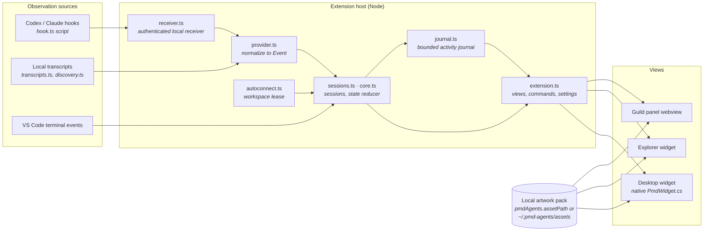
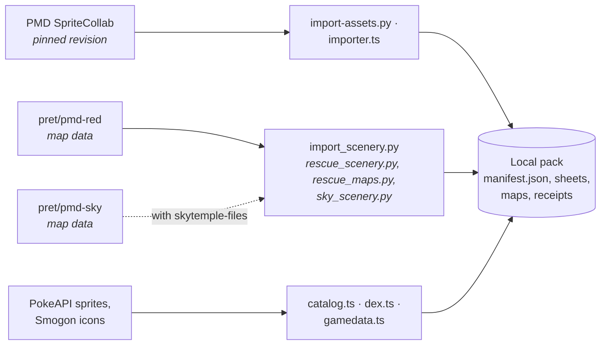

# Architecture

PMD Agents is a VS Code extension that shows local coding-agent sessions (Codex, Claude Code and
terminal jobs) as Pokémon in a Mystery Dungeon guild. Everything runs on your machine: the
extension host observes sessions, reduces them to a small, privacy-filtered state, and
webviews draw the guild from a local artwork pack that is never bundled or uploaded.

For setup and use, see [README.md](README.md). Dated evidence and gaps are in
[docs/IMPLEMENTATION.md](docs/IMPLEMENTATION.md), and product decisions in [docs/PLAN.md](docs/PLAN.md).

## Overview

## Extension host (`src/`)

| Module | Responsibility |
| --- | --- |
| `extension.ts` | Activation, the guild panel, Explorer widget and desktop companion, commands and settings |
| `receiver.ts`, `hook.ts`, `setup.ts`, `hooks-config.ts` | One receiver per window on a random loopback port with a random bearer token, registered in `~/.pmd-agents/instances`; the hook script posts events to it; guided hook installation into Codex and Claude settings |
| `transcripts.ts`, `discovery.ts`, `connectionStatus.ts` | Versioned readers of local transcript structure, Codex directory discovery, and honest explanations of what could not be observed |
| `provider.ts`, `core.ts`, `sessions.ts` | Normalising provider records into events; the session model, attention and ordering rules |
| `autoconnect.ts` | Workspace-scoped automatic attachment with a lease, paused when guild windows overlap |
| `journal.ts` | A bounded activity journal of tool and status lines, with no raw chat text |
| `favorites.ts` | Spawning: a new teammate gets the first favorite no active teammate is using, then a random unused species; favorites come from the `pmdAgents.favorites` setting |
| `storage.ts` | Atomic writes and file locks for state shared between windows |
| `desktop.ts`, `native/PmdWidget.cs` | The Windows desktop companion window |

**Privacy.** The host hashes provider identities and discards prompts, tool arguments, outputs
and full paths before anything reaches a view. Hooks take priority over transcript replay;
time alone never marks work as complete.

**Window membership.** A verified window token puts a session in this window's guild. In auto
mode, a single eligible workspace window can claim it. Anything else stays an unassigned
candidate until you attach it. Directory equality is never treated as proof of window ownership.

## Guild view (`src/webview/`)

| Module | Responsibility |
| --- | --- |
| `app.ts` | The canvas world: map, scenery layers, teammates, Substitute training, scouting and wandering, journal and controls |
| `navigation.ts` | Floor zones, an 8 px navigation grid with checked edges, routes and six reachable work stations per map. Terrain is built on first use |
| `placement.ts`, `training.ts` | Stable roster order and arrivals; native attack moves with their own timing and hit frames |
| `pc.ts` | The Pokémon storage system: boxes, forms, choices and the ordered Favorites list |

Animation is independent of session status. Quiet mode, reduced motion and hidden views stop
both scenery and Pokémon motion.

## Artwork pack

The pack is a local folder (the `pmdAgents.assetPath` setting, else `~/.pmd-agents/assets`) with a `manifest.json`, validated by `assets.ts` (geometry, anchors,
timing, at most 128 maps) before anything is drawn. It is never part of Git or the VSIX.

- **Sprites** come from SpriteCollab at a pinned revision, with credits and SHA-256 receipts.
  The Python and TypeScript importers measure identical anchors.
- **Friend Areas** are decoded from the pret decompilations: 57 Red Rescue Team maps always, and
  16 Explorers of Sky maps when skytemple-files is installed. Each map has native palette and
  tile animation and a source receipt. Floors are authored for the original eleven maps and taken
  from the native collision layer for the rest. Area data is in `assets/friend-areas.json`.
- **The living Pokédex** (storage system) reads SpriteCollab's tracker, PokeAPI fronts and types,
  and Smogon box icons, all pinned and fetched only as you browse.

## Tests

| Command | Covers |
| --- | --- |
| `npm run typecheck`, `npm test` | Event ordering, attention, membership, recovery, journal, placement, parsing, PNG and AnimData decoding, the Pokédex, navigation on every map |
| `python scripts/test_rescue_scenery.py` | Map decoder fixtures |
| `npm run test:browser`, `test:training`, `test:widget` | The guild against a local pack: motion, every map's animated scenery, Quiet, storage, training moves, compact layouts |
| `npm run test:extension`, `test:package` | A real VS Code instance in an isolated profile, from source and from the packaged VSIX |

Pack-dependent tests are skipped in source-only CI.
