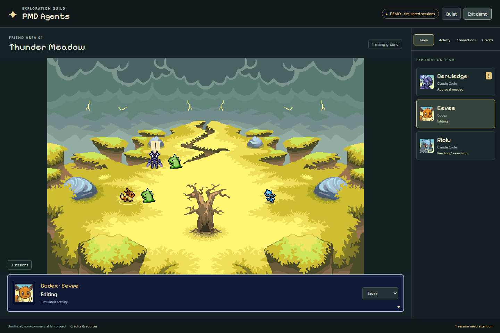
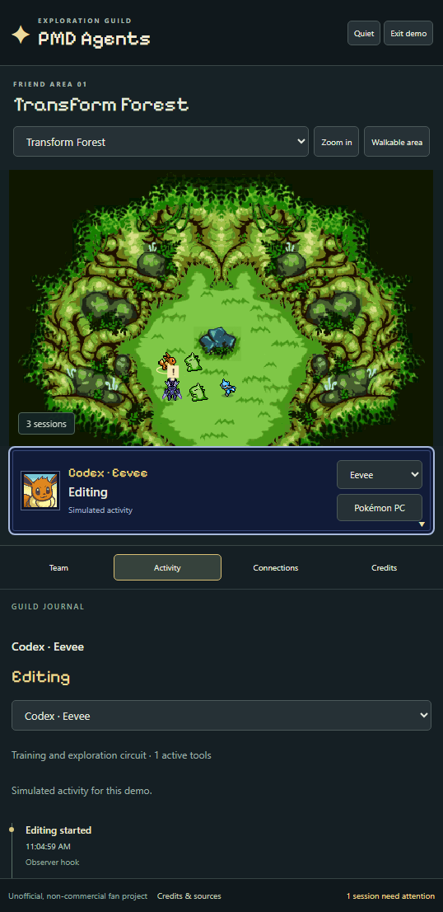
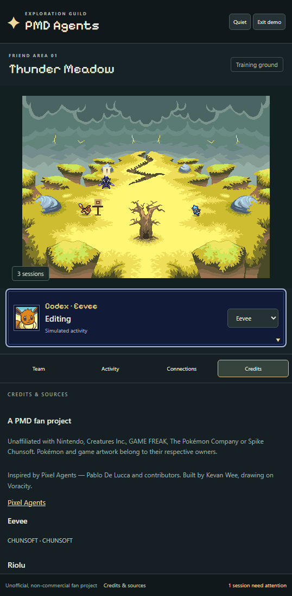
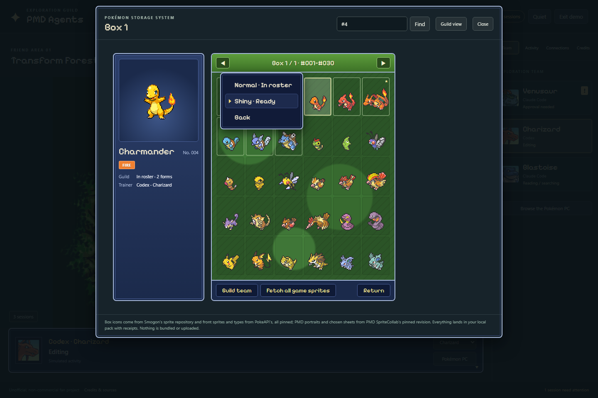
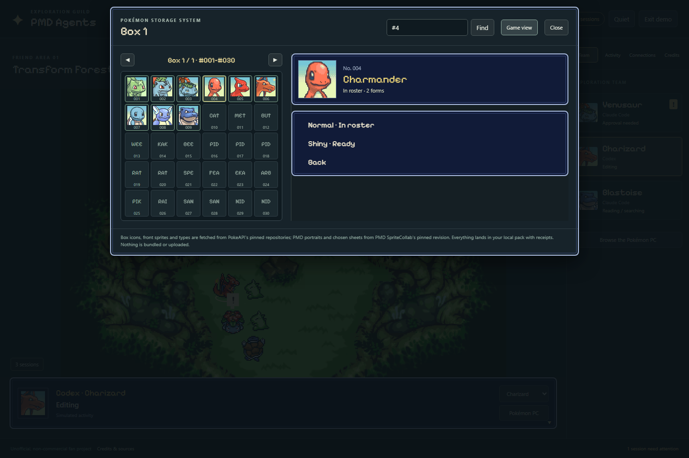
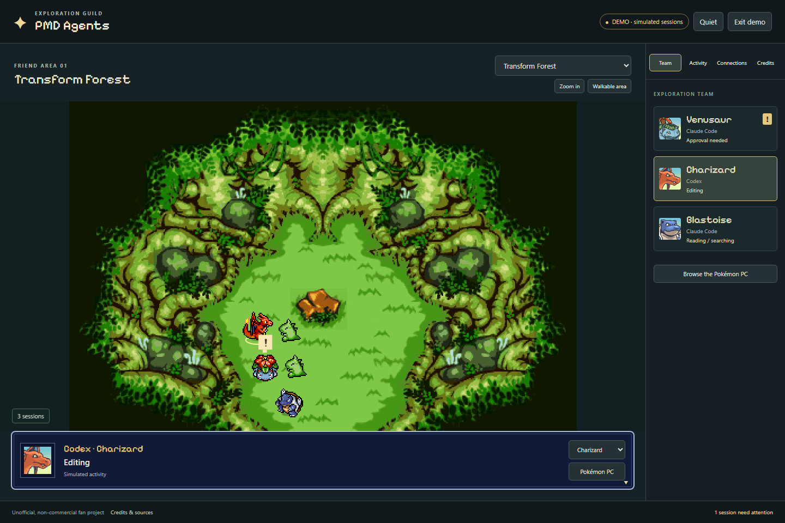
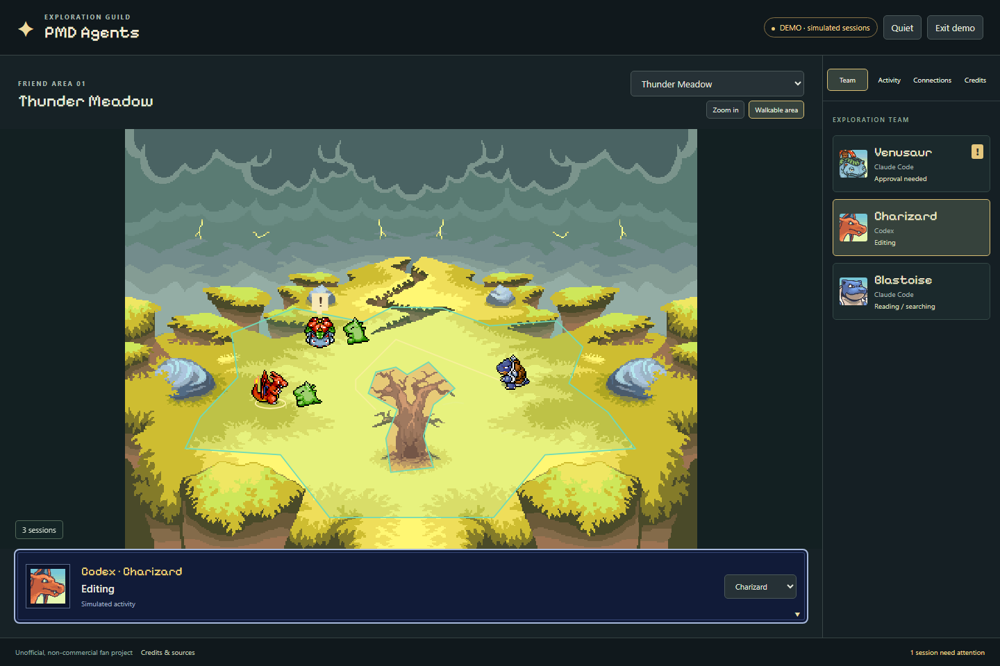
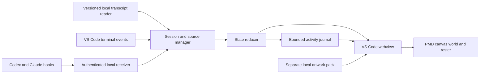
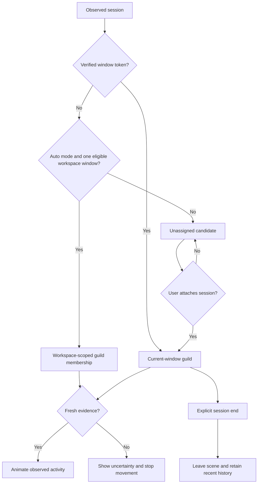

# PMD Agents

**Your coding agents, as a Pokémon Mystery Dungeon exploration team.**

PMD Agents is a local VS Code extension inspired by [Pixel Agents](https://github.com/pixel-agents-hq/pixel-agents). Codex chats, Claude Code sessions and terminal jobs appear as Pokémon in selectable PMD Friend Areas: training against Substitute while working, scouting while reading, and stopping when they need your attention.

[](https://github.com/kevanwee/pmd-agents/actions/workflows/ci.yml)
[](https://github.com/kevanwee/pmd-agents/releases/tag/v0.5.2)


> **[Download 0.5.2](https://github.com/kevanwee/pmd-agents/releases/tag/v0.5.2)** for local Windows x64. Game artwork is installed separately. Terminal tracking and live Codex transcript observation are verified locally; live native Claude chat tracking remains unverified. This is an unofficial fan project; publication does not grant third-party artwork or branding rights.

## Start here

The installable package is for **local Windows x64 and VS Code 1.109+**. The desktop widget also needs the [Microsoft Edge WebView2 Runtime](https://developer.microsoft.com/en-us/microsoft-edge/webview2/). WSL, SSH, containers and other operating systems are not release-tested. Install the extension in every VS Code profile where you want it; new trusted windows in that profile activate it and reveal the Explorer widget automatically without taking keyboard focus. Set `pmdAgents.autoShowWidget` to `false` if you prefer to keep the sidebar hidden.

Install the release:

1. Download the [0.5.2 VSIX](https://github.com/kevanwee/pmd-agents/releases/download/v0.5.2/pmd-agents-0.5.2.vsix) and [SHA-256 checksum](https://github.com/kevanwee/pmd-agents/releases/download/v0.5.2/pmd-agents-0.5.2.vsix.sha256). Compare the checksum with `Get-FileHash .\pmd-agents-0.5.2.vsix -Algorithm SHA256`.
2. In VS Code, run **Extensions: Install from VSIX**, select the download, then **Developer: Reload Window**. Node.js, npm and Python are not needed to install or run the VSIX.
3. Open **PMD Agents** in Explorer, then **Open guild**. Trust only workspaces you trust to run local extensions.
4. Under **Connections → Choose asset pack**, select a folder containing a compatible `manifest.json` and artwork you are permitted to use. **The VSIX includes no game artwork.** Without a pack, session observation works but the animated scene is unavailable. Existing source import tools need a source checkout, Python and Pillow; see [Import artwork](#import-artwork). They do not establish permission to use the downloaded material.
5. Open your coding project's folder. Recent supported Codex/Claude records are observed locally by default. Keep the status bar visible until the PMD item's tooltip confirms the desktop widget follows this window. Minimize VS Code to show it; minimizing the widget dismisses it for that cycle.

For building from source, follow [Run locally](#run-locally). For missing art, connection issues, updates and removal, see the [setup guide](docs/SETUP.md). Maintainers: use the [release checklist](docs/RELEASING.md).

The original code uses a [proprietary use licence](LICENSE): installation and personal use, including your own work, are allowed; redistribution requires permission, subject to the licence's exceptions. Third-party material has separate terms. A free download, attribution or an unofficial-project notice is not artwork clearance.



*Screenshots use explicitly simulated sessions. They demonstrate the UI and animations, not live provider coverage.*

## What the guild does

- **Lives in Explorer.** A compact guild opens in every trusted window using the installed VS Code profile. On local Windows x64, minimizing that window brings up its own always-on-top desktop widget.
- **Observes your existing workflow.** Keep using native Codex and Claude Code chats and VS Code terminals. PMD Agents is an observer, not a replacement chat client.
- **Uses authentic PMD animations.** Directional sheets, native frame durations, portraits and shadow anchors; no four-frame sprite assumptions.
- **Reconnects automatically.** Supported recent workspace chats join without Scan or Add. Overlapping guild windows pause automatic attachment instead of silently claiming the same chat.
- **Makes activity visible.** Working, editing and command-running sessions rotate through their available native Attack, Shoot, Strike, QuickStrike, MultiStrike and SpAttack sheets against Substitute, without repeating aliases of the same sheet. Attention stops training immediately.
- **Keeps session identity stable.** Teammates joining or leaving does not reshuffle existing Pokémon. Extra sessions use additional clearings.
- **Shows its evidence.** An Activity journal lists observed events, timestamps and sources. Missing evidence becomes uncertainty, never invented success.
- **Lets you choose the team.** Attach ambiguous sessions, open the Pokémon storage system to pick any drawn species or form in National Dex order, link an agent to its terminal, or remove it from the guild without stopping it.
- **Stays local.** No hosted backend, additional model calls or paid infrastructure is needed for observation. Existing agent usage keeps its own costs and limits.

## Screenshots

<table>
<tr>
<td width="50%"></td>
<td width="50%"></td>
</tr>
<tr><td>Observed activity, separated from animation.</td><td>Fan-project notice and individual credits.</td></tr>
</table>

## Pokémon storage system

Select a teammate, then press **Pokémon PC** in its portrait card (or **Browse the Pokémon PC** under the team list). The storage system shows every species in National Dex order, thirty to a box, laid out like the PC in the main-series games: the box with its icons on the right, the selected Pokémon's front sprite, number and types on the left, and a bar with **Guild team**, **Fetch all game sprites** and **Return**. **Guild team** swaps the left panel for your sessions and their current Pokémon; the box stays open, so you can pick a teammate, choose from the box, pick the next teammate and keep going until the whole team is dressed. Opening a Pokémon pops up its menu:

- **Choose** assigns it to the selected session. A species that is not in your local pack yet is imported first (**Import & choose**).
- **Forms** lists the shiny, female and alternate forms that SpriteCollab has drawn, each marked *In roster*, *Ready*, *Portrait only* or *Not drawn yet*. Ready forms can be chosen like any species; pointing at a shiny form shows the shiny front sprite.
- **Summary** shows the types, how many forms and animations are recorded, the primary sprite credit and a link to the exact source folder.

Arrow keys move the cursor, Page Up / Page Down change boxes, Enter opens the menu, Escape steps back one level, and the search field accepts a name or `#number`. **Guild view** switches to the alternative layout with PMD SpriteCollab portraits in the slots and the menu beside the box; the choice is remembered.





The catalog comes from SpriteCollab's own tracker at the pinned revision (1,025 species, about 4,000 drawn forms, about 3,200 with the Idle, Walk, Attack and Sleep sheets the guild needs). The game view's box icons come from the [Smogon / Pokémon Showdown sprite repository](https://github.com/smogon/sprites): one Gen 6/7 menu-sprite style for all 1,025 species (Generation VIII and IX icons are the Smogon community's in that style), drawn at their natural size times two so every Pokémon sits on the same scale, as in the games. Front sprites and shiny fronts come from the [PokeAPI sprites repository](https://github.com/PokeAPI/sprites) on a uniform 96 × 96 canvas, and types from [PokeAPI's CSV data](https://github.com/PokeAPI/pokeapi). All sources are pinned. They are fetched a box at a time as you browse, or all at once with **Fetch all game sprites** (3,075 files) or `npm run import:game`. PMD portraits and chosen sprite sets are fetched into your local pack with the original credit records and SHA-256 receipts, then validated for geometry, anchors and timing before they can be chosen. Nothing fetched is bundled or uploaded. The starter pack still comes from [`assets/roster.json`](assets/roster.json) and the Python importer; both importers measure the same anchors from the same sheets. Substitute is a training prop, not a selectable agent. Existing packs keep working with Attack alone. To add the expanded combat sheets without replacing your roster or maps, run `npm run import:training -- --output "C:/path/to/your/pack"` from the source checkout, then reload VS Code. New imports include those sheets automatically when available.

Move colours follow the species' primary type for every type, from the pack's own record or PokeAPI's data. Forms without their own portrait borrow the nearest drawn one, which the summary says. The tracker's completion phase decides what counts as *Ready*; the importer still verifies every sheet, so a stale tracker entry fails honestly instead of producing a broken teammate.



## Persistent widget

The **PMD Agents** view lives in Explorer alongside your files. Drag its heading to
place it below Outline, or resize it like other sidebar views. VS Code remembers
your placement. **PMD Agents: Show Sidebar Widget** brings it back if hidden.
**Open guild** opens the full team, activity journal and Pokémon PC.

On **local Windows x64**, the desktop companion starts automatically. Minimize
VS Code and its guild appears above other apps; restore VS Code and it hides.
Minimize or close the widget to dismiss it for that minimize cycle. Restore it
from its tray icon, **Pop out**, or **PMD Agents: Show Desktop Widget**. You can
also pop it out while VS Code is open. Each window owns a separate companion;
closing that window closes its companion. Its position is remembered per
workspace; it always opens at **PMD Agents: Desktop Widget Width** × **Height**
(460 × 440 by default), and changing those settings resizes an open widget.
Friend Area/Quiet changes synchronize with the full guild. Once your asset pack is
set up, the window and tray icon are Appletun, fetched from the pinned SpriteCollab
revision into the pack with a receipt (never bundled).

Automatic window matching requires the PMD status-bar item to be visible once
after startup. Keep the status bar visible until the item's tooltip says the
widget follows this window; hiding it afterwards is fine. If it is hidden at
startup (for example in Zen Mode), manual pop-out still works. The companion
never guesses ownership from a folder or window title.

Set **PMD Agents: Desktop Widget** off to use only Explorer. The native companion
needs the Microsoft Edge WebView2 Runtime, normally already installed on Windows.
Other operating systems and remote extension hosts retain the Explorer widget;
the desktop companion is not supported there. Restricted/untrusted workspaces
keep the extension disabled. New VS Code profiles need the extension installed
in that profile too. Reload existing windows after installing an update.

## Run locally

Requires **Node.js 22+**, npm and **VS Code 1.109+**. Importing artwork also requires Python 3 and Pillow. Windows local is the tested environment; remote hosts are not yet verified. Packaging the desktop companion requires Windows x64, Python 3 and the .NET Framework compiler included with Windows; the build downloads a hash-pinned WebView2 SDK and includes its licence. Ordinary TypeScript builds remain cross-platform.

```powershell
git clone https://github.com/kevanwee/pmd-agents.git
cd pmd-agents
npm ci
npm run typecheck
npm test
npm run package
```

In VS Code:

1. Run **Extensions: Install from VSIX** and choose `artifacts/pmd-agents-0.6.0.vsix`.
2. Run **Developer: Reload Window**, then look for **PMD Agents** in Explorer. **Open guild** opens its full controls.
3. Choose a local artwork pack under **Connections → Choose asset pack**.
4. Every discovered session spawns a Pokémon as it appears. **Connections → Auto-attach** controls this (and **Workspace auto-connect** the narrower, verified-workspace mode). If another guild window shares the same folders, automatic attachment pauses and you choose the intended session manually.

The extension can observe sessions without artwork; the scene needs a complete local pack. It checks development `assets/local`, then `~/.pmd-agents/assets`, or the configured `pmdAgents.assetPath`.

### Import artwork

Source sheets and game maps are **not included in Git or the VSIX**. The importer downloads pinned SpriteCollab sheets, all 57 original Red Rescue Team Friend Areas from [pret/pmd-red](https://github.com/pret/pmd-red), 16 Explorers of Sky Friend Areas from [pret/pmd-sky](https://github.com/pret/pmd-sky) when [skytemple-files](https://github.com/SkyTemple/skytemple-files) is installed (Python 3.10–3.13), and Pixelify Sans. Maps are decoded from native tile and palette data, including original palette frames and durations, with source hashes recorded in the local pack. Python and Pillow are required. To refresh only maps while preserving your imported Pokemon, run `npm run import:scenery -- --output C:/path/to/your/pack`.

```powershell
python -m pip install Pillow
python scripts/import-assets.py
```

The importer writes `assets/local/manifest.json`, original credit records and file hashes. Use `--output` to select another local pack directory. See [asset handling and credits](docs/ATTRIBUTION.md).

The storage system needs no Python: the extension builds `dex.json` from the pinned tracker the first time the PC opens and imports chosen Pokémon itself. To prepare the catalog ahead of time, or refresh it after changing the pinned revision, run `npm run import:dex` (optionally with a pack directory). `npm run import:game` fetches every box icon, front and shiny sprite plus type data in one pass; the PC's **Fetch all game sprites** button does the same from inside VS Code.

### Connect agents

| Source | What works today | Practical limit |
| --- | --- | --- |
| Codex native VS Code chat | Live transcript observation verified on 0.162.0-alpha.17.2; hook adapter available | Workspace auto-connect; native hook/approval coverage still needs validation |
| Claude native VS Code chat | Actual 2.1.295/2.1.296 records replayed; synthetic automatic attachment verified | A live native chat remains unverified |
| Claude CLI | Live turn start, activity and finish verified on standalone 2.1.77 and bundled 2.1.296 | Native chat UI, live approvals and child-agent lifecycle remain unverified |
| VS Code terminal | Open/close, shell command start/end and exit result verified | Without shell integration: terminal presence only |
| Other agent CLIs | Generic terminal activity | Internal reasoning, tools and children require an adapter |
| WSL, SSH, containers | Observer runs in the workspace extension host | Not tested; local Windows logs are not remote-host logs |

**Connections → Connect Codex / Connect Claude → Install hooks** shows the destination and writes the observer configuration for you. No copying or saving JSON is required. Unrelated settings are preserved, changed files are backed up, and **PMD Agents: Remove Provider Hooks** removes only this observer. Codex requires its own `/hooks` trust review. PMD Agents never grants provider approvals.

Use **Manage guild** to link a terminal-launched agent to its terminal. Native panel chats should stay separate from unrelated terminals. Workspace auto mode reconnects qualifying chats after reload; exclusions, Pokémon choices and map choice are saved. Manual-only attachments and terminal links still last for the extension activation.

### Maps and movement

Choose the **Friend area** dropdown above the scene:

- **Transform Forest:** lossless 32-frame evolution stone, six native ticks (100 ms) per frame.
- **Thunder Meadow, Mt. Moonview, Decrepit Lab, Seafloor Cave, Volcanic Pit, Legendary Island, Healing Forest and Waterfall Lake:** original palette animation, including magma flows, water, lights and shimmer.
- **Mushroom Forest and Rainbow Peak:** original static scenery; these maps contain no palette or tile animation.
- **Every other Red Rescue Team Friend Area** (Bountiful Sea to Final Island, 57 in all), with native palette animation and, where the game has it, tile animation (Southern Island's surf, the Crater's vent, the Power Plant's generators).
- **Explorers of Sky:** Crystal Crossing and 15 more areas such as Guild Crossroads, Temple Steps and Magma Platform, when skytemple-files is installed.

Every map has six reachable training stations with safe dummy positions. The original eleven keep their authored movement zones; the others walk on the game's own collision layer (largest open region), or on authored zones for the six Explorers maps without one. Each map's floor and routes are built only when it is shown. Scenery updates independently of agent activity; Quiet and reduced motion freeze it.

Pokémon now find routes around obstacles across the clearing, rather than moving 14 pixels either side of a station. Active workers alternate training and exploration; readers scout and recent idle teammates wander before resting. **Walkable area** shows the floor boundaries and routes: measured from the artwork on the original eleven maps, and from native collision data on the rest. **Zoom in** supports dragging; **Fit map** restores the whole scene. Quiet and reduced motion stop environment animation as well as Pokémon motion.



### Automatic connection and scope

Automatic discovery runs in the background; the Scan button is only a manual refresh. Supported files modified within 12 hours qualify. Older Codex creation-date folders are checked in batches, so resumed historical threads may take several scans to appear.

**Auto-attach** (default on) spawns a Pokémon for every discovered live session, including hook events that arrive without a window token. It is a convenience, not proof of which window owns a chat, and it pauses while another guild window shares these folders. Turning it off releases only the sessions it attached; window-bound, workspace and manual membership stay. **Workspace auto** intentionally includes local chats matching this workspace. It does not prove which native editor window or external terminal owns each chat. A local heartbeat registry, containing hashed folder identities, detects overlapping guild windows and pauses automatic attachment for those folders. Explicitly window-bound terminals/hooks still connect directly; unscoped hook events reconnect when the overlap clears. Candidate cards explain exclusions, observation failures, disabled automatic connection or window ambiguity. You can switch automatic attachment off or remove individual sessions, which stay excluded after reload.

In **Activity**, use the source picker to switch between Codex, Claude and terminal journals. A terminal’s shell events are separate from a native chat’s events. Newly discovered chats become the default selection unless you have already chosen a teammate.

### Read the world

| Observed state | Pokémon behaviour |
| --- | --- |
| Working / thinking / responding | Train against Substitute, then explore between bouts |
| Reading / searching | Routes across the clearing |
| Editing or running a command | Training and exploration circuit |
| Approval or input requested | Idle in place with an attention bubble |
| Turn finished | Rest, then sleep |
| Stale, paused or unavailable observation | Stop and show uncertainty |

Move colours follow the Pokémon’s primary type, one pair of tones for each of the eighteen types. Attacks, projectiles and hit reactions are decorative; they do not count tool calls, measure progress or imply successful work.

Quiet and reduced-motion settings stop movement while keeping status visible. “Turn finished” does not mean the requested software is correct or the whole task is complete. A generic command exiting zero is not automatically a test pass.

## How it works



The host hashes provider identities and discards prompts, arguments, outputs and full paths before sending state to the view. Transcript readers inspect local record structure; raw chat text is neither retained in the journal nor uploaded.



Hooks take priority over transcript replay. After hook silence, a newer live transcript event can recover observation; time alone never produces success. Tool activity is tracked concurrently, with duplicate and late-event protection. A linked terminal closing does not automatically end its provider session.

[ARCHITECTURE.md](ARCHITECTURE.md) maps the modules, views, artwork pack and tests.

## Development and verification

```powershell
npm run typecheck
npm test
npm run build
npx playwright install chromium
npm run test:browser
npm run test:extension
npm run package
```

- Unit checks cover event ordering, attention, window membership, source recovery, bounded history, stable placement, transport, parsing, the PNG decoder, AnimData parsing, the Pokédex catalog and the main-series sprite and type data.
- The asset integrity, anchor-equivalence and import tests run when the ignored local pack exists; source-only CI reports them skipped. The anchor test confirms the TypeScript importer measures exactly the anchors the Python importer measured for every local sheet.
- Browser checks require that pack and start a temporary preview server automatically. They verify motion, attention idle loops, clearings, journal contents, the storage system (boxes, forms menu, keyboard navigation, a chosen import) and narrow layouts.
- VS Code tests launch an isolated profile and exercise real shell integration. Set `PMD_VSCODE_EXECUTABLE` for another installation.
- `npm run preview` opens a browser demo at `http://127.0.0.1:5188`; it is not a live browser monitor.
- `npm run screenshots` regenerates the committed, labelled demo screenshots. Real session screenshots, logs and probe exports stay in ignored `artifacts`.

The repository is public. Earlier private-repository Actions jobs were blocked by an account billing/spending restriction; current workflow status is shown by the Checks badge. No billing settings were changed.

The local build has **68 focused tests**, plus browser and VS Code integration checks. CI verifies source-only checks, not native provider coverage. See the dated [implementation evidence](docs/IMPLEMENTATION.md) for exact versions and gaps.

See the [0.4.3 code review](docs/REVIEW-2026-10-10.md) for findings and remaining reliability work.

## Roadmap

- [x] Archive The Office and establish a separate PMD architecture
- [x] Real PMD scene, native animation metadata, portraits and credits
- [x] Terminal observation, Codex transcript observation and explicit attachment
- [x] Activity journal, stable placement, attention and terminal linking
- [ ] Live Claude native-chat and both providers' approval/subagent validation
- [x] Bounded historical-folder discovery for resumed Codex sessions
- [x] Substitute training and all nine Kanto starter stages
- [x] Workspace automatic reconnection, persistent exclusions and overlapping-window checks
- [x] Animated Transform Forest, expanded meadow navigation, map selection and zoom
- [x] Pokémon storage system: the full National Dex with forms, on-demand validated imports and credits
- [x] Main-series game view as the primary storage layout, with every box icon, front and shiny sprite and typed move colours
- [ ] Durable exact-window manual attachment restoration and process reconciliation
- [ ] Outcome poses (Hurt, Pose) and optional dungeon presentation

The [full plan](docs/PLAN.md) separates delivered work from future proposals. [Research](docs/RESEARCH.md) records the predecessor review and archive receipt.

## Credits and licence

Built by **Kevan Wee**. Inspired by **Pablo De Lucca and the Pixel Agents contributors**; no Pixel Agents source code is copied in this implementation. [The Office](https://github.com/kevanwee/theoffice) is the archived predecessor.

Sprite/portrait records credit **CHUNSOFT, baronessfaron, Fearless-Quit, Top_Kec, JFain, 0palite, Emboarger, Emmuffin, Grimlin, G〜 and bwappi**, plus contributors recorded upstream as Discord IDs **199989579682414592** and **276175146304405514**, sourced through [PMD SpriteCollab](https://github.com/PMDCollab/SpriteCollab). Pokémon imported through the storage system carry their own contributors from the same credit records into the in-guild Credits view and the local manifest. The storage system's box icons come from the [Smogon / Pokémon Showdown sprite repository](https://github.com/smogon/sprites) (Gen 6/7 menu sprites; Generation VIII and IX icons by the Smogon community), and its front and shiny sprites from the [PokeAPI sprites repository](https://github.com/PokeAPI/sprites) (later generations by the Smogon Sprite Project), each at a pinned revision. All depict Nintendo, Creatures Inc. and GAME FREAK characters, and its type data comes from [PokeAPI](https://github.com/PokeAPI/pokeapi) (BSD-3-Clause); both stay in the local pack with receipts. Original game sprites and individual fan-art terms are distinguished in the pack; a repository-wide fan-art licence is not assumed to cover every asset. **Pixelify Sans Project Authors** provide the font under SIL OFL. Transform Forest and its stone frames credit **Toastypk**, with the **Pamtre Berry / Taliax** mirror and original source receipts retained locally. Thunder Meadow is a local game-map reference; its original ripper remains unresolved. Screenshots contain rendered third-party artwork and retain those attributions.

Original project code is **proprietary**, with permission to install, run and privately modify it; see [LICENSE](LICENSE) and [NOTICE.md](NOTICE.md). Redistribution requires permission, subject to the licence's exceptions. This repository does not grant rights to third-party artwork. Source sheets and game maps remain outside the repository and installable package; rendered artwork is present in the public screenshots.

**PMD Agents is an unofficial, non-commercial Pokémon Mystery Dungeon fan project.** It is not affiliated with, endorsed by or sponsored by Nintendo, Creatures Inc., GAME FREAK, The Pokémon Company or Spike Chunsoft. Pokémon and Pokémon Mystery Dungeon names, characters and game artwork belong to their respective owners.

### Workspace discovery

The installed extension activates in each trusted VS Code window and reads that window's current workspace folders. It is not tied to the repository used to build it. Folder additions/removals restart observation automatically. The empty guild and Connections show the current folder names and distinguish activity in other projects, disabled observation and overlapping windows. Use **Add project folder** when a chat works outside the open workspace, or open its project in its own window. Unrelated windows remain separate; shared-folder ambiguity still pauses automatic attachment. New windows use the shared local asset pack. An installed update needs **Developer: Reload Window** before an already-running guild uses it.
