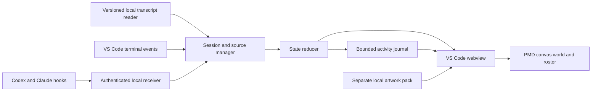
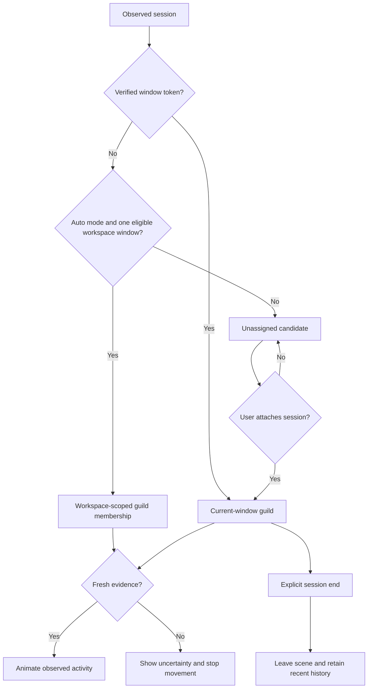

# PMD Agents

**Your coding agents, as a Pokémon Mystery Dungeon exploration team.**

PMD Agents is a local VS Code extension inspired by [Pixel Agents](https://github.com/pixel-agents-hq/pixel-agents). Codex chats, Claude Code sessions and terminal jobs appear as Pokémon in selectable PMD Friend Areas: training against Substitute while working, scouting while reading, and stopping when they need your attention.

[](https://github.com/kevanwee/pmd-agents/actions/workflows/ci.yml)


> **Development build 0.4.0.** Terminal tracking and live Codex transcript observation are verified locally. Native Claude records have been replayed successfully; live Claude chat tracking still needs validation. This is an unofficial, non-commercial fan project.


*Screenshots use explicitly simulated sessions. They demonstrate the UI and animations, not live provider coverage.*

## What the guild does

- **Observes your existing workflow.** Keep using native Codex and Claude Code chats and VS Code terminals. PMD Agents is an observer, not a replacement chat client.
- **Uses authentic PMD animations.** Directional sheets, native frame durations, portraits and shadow anchors; no four-frame sprite assumptions.
- **Reconnects automatically.** Supported recent workspace chats join without Scan or Add. Overlapping guild windows pause automatic attachment instead of silently claiming the same chat.
- **Makes activity visible.** Working, editing and command-running sessions practise attacks and ranged moves against Substitute. Attention stops training immediately.
- **Keeps session identity stable.** Teammates joining or leaving does not reshuffle existing Pokémon. Extra sessions use additional clearings.
- **Shows its evidence.** An Activity journal lists observed events, timestamps and sources. Missing evidence becomes uncertainty, never invented success.
- **Lets you choose the team.** Attach ambiguous sessions, open the Pokémon storage system to pick any drawn species or form in National Dex order, link an agent to its terminal, or remove it from the guild without stopping it.
- **Stays local.** No hosted backend, additional model calls or paid infrastructure is needed for observation. Existing agent usage keeps its own costs and limits.

## Screenshots

<table>
<tr>
<td width="50%"></td>
<td width="50%"></td>
</tr>
<tr><td>Observed activity, separated from animation.</td><td>Fan-project notice and individual credits.</td></tr>
</table>

## Pokémon storage system

Select a teammate, then press **Pokémon PC** in its portrait card (or **Browse the Pokémon PC** under the team list). The storage system shows every species in National Dex order, thirty to a box, laid out like the PC in the main-series games: the box with its icons on the right, the selected Pokémon's front sprite, number and types on the left, and a bar with **Guild team** (pick which teammate you are dressing), **Fetch all game sprites** and **Return**. Opening a Pokémon pops up its menu:

- **Choose** assigns it to the selected session. A species that is not in your local pack yet is imported first (**Import & choose**).
- **Forms** lists the shiny, female and alternate forms that SpriteCollab has drawn, each marked *In roster*, *Ready*, *Portrait only* or *Not drawn yet*. Ready forms can be chosen like any species; pointing at a shiny form shows the shiny front sprite.
- **Summary** shows the types, how many forms and animations are recorded, the primary sprite credit and a link to the exact source folder.

Arrow keys move the cursor, Page Up / Page Down change boxes, Enter opens the menu, Escape steps back one level, and the search field accepts a name or `#number`. **Guild view** switches to the alternative layout with PMD SpriteCollab portraits in the slots and the menu beside the box; the choice is remembered.


The catalog comes from SpriteCollab's own tracker at the pinned revision (1,025 species, about 4,000 drawn forms, about 3,200 with the Idle, Walk, Attack and Sleep sheets the guild needs). The game view's box icons (Generation VIII style, through #898; later species show their front sprite scaled down), front sprites and shiny fronts come from the [PokeAPI sprites repository](https://github.com/PokeAPI/sprites) and types from [PokeAPI's CSV data](https://github.com/PokeAPI/pokeapi), both at pinned revisions. They are fetched a box at a time as you browse, or all at once with **Fetch all game sprites** (about 2,950 files) or `npm run import:game`. PMD portraits and chosen sprite sets are fetched into your local pack with the original credit records and SHA-256 receipts, then validated for geometry, anchors and timing before they can be chosen. Nothing fetched is bundled or uploaded. The starter pack still comes from [`assets/roster.json`](assets/roster.json) and the Python importer; both importers measure the same anchors from the same sheets. Substitute is a training prop, not a selectable agent.

Move colours follow the species' primary type for every type, from the pack's own record or PokeAPI's data. Forms without their own portrait borrow the nearest drawn one, which the summary says. The tracker's completion phase decides what counts as *Ready*; the importer still verifies every sheet, so a stale tracker entry fails honestly instead of producing a broken teammate.


## Run locally

Requires **Node.js 22+**, npm and **VS Code 1.109+**. Importing artwork also requires Python 3 and Pillow. Windows local is the tested environment; remote hosts are not yet verified.

```powershell
git clone https://github.com/kevanwee/pmd-agents.git
cd pmd-agents
npm ci
npm run typecheck
npm test
npm run package
```

In VS Code:

1. Run **Extensions: Install from VSIX** and choose `artifacts/pmd-agents-0.4.0.vsix`.
2. Run **Developer: Reload Window**, then **PMD Agents: Open Guild**.
3. Choose a local artwork pack under **Connections → Choose asset pack**.
4. Supported recent chats from your workspace connect automatically. **Connections → Auto-connect** controls this. If another guild window shares the same folders, choose the intended session manually.

The extension can observe sessions without artwork; the scene needs a complete local pack. It checks development `assets/local`, then `~/.pmd-agents/assets`, or the configured `pmdAgents.assetPath`.

### Import artwork

Source sheets and game maps are **not included in Git or the VSIX**. The current importer downloads pinned SpriteCollab sheets and reads the Thunder Meadow and Transform Forest maps, stone animation and Pixelify Sans font from a local Voracity checkout. Without those local map/font inputs, obtain a compatible pack first; cloning this repository alone does not provide them.

```powershell
python -m pip install Pillow
python scripts/import-assets.py --voracity "path/to/voracity"
```

The importer writes `assets/local/manifest.json`, original credit records and file hashes. Use `--output` to select another local pack directory. See [asset handling and credits](docs/ATTRIBUTION.md).

The storage system needs no Python: the extension builds `dex.json` from the pinned tracker the first time the PC opens and imports chosen Pokémon itself. To prepare the catalog ahead of time, or refresh it after changing the pinned revision, run `npm run import:dex` (optionally with a pack directory). `npm run import:game` fetches every main-series box icon, front and shiny sprite plus type data in one pass; the PC's **Fetch all game sprites** button does the same from inside VS Code.

### Connect agents

| Source | What works today | Practical limit |
| --- | --- | --- |
| Codex native VS Code chat | Live transcript observation verified on 0.162.0-alpha.2; hook adapter available | Workspace auto-connect; native hook/approval coverage still needs validation |
| Claude native VS Code chat | Actual 2.1.289 records replayed; 2.1.292 schema inspected | A live native chat remains unverified |
| Claude CLI | Real startup hook received; lifecycle adapter implemented | Full live-turn coverage remains unverified |
| VS Code terminal | Open/close, shell command start/end and exit result verified | Without shell integration: terminal presence only |
| Other agent CLIs | Generic terminal activity | Internal reasoning, tools and children require an adapter |
| WSL, SSH, containers | Observer runs in the workspace extension host | Not tested; local Windows logs are not remote-host logs |

**Connections → Connect Codex / Connect Claude → Install hooks** shows the destination and writes the observer configuration for you. No copying or saving JSON is required. Unrelated settings are preserved, changed files are backed up, and **PMD Agents: Remove Provider Hooks** removes only this observer. Codex requires its own `/hooks` trust review. PMD Agents never grants provider approvals.

Use **Manage guild** to link a terminal-launched agent to its terminal. Native panel chats should stay separate from unrelated terminals. Workspace auto mode reconnects qualifying chats after reload; exclusions, Pokémon choices and map choice are saved. Manual-only attachments and terminal links still last for the extension activation.

### Maps and movement

Choose the **Friend area** dropdown above the scene:

- **Transform Forest:** a 32-frame evolution-stone layer, sourced through Toastypk’s rip and the [Pamtre Berry mirror](https://pamtre-berry.neocities.org/articles/friendareas). The mirror frames have JPEG artefacts; playback is 120 ms per pose because original game timing was not supplied.
- **Thunder Meadow:** a wider authored walkable area, a tighter tree obstacle and original ambient breeze effects. This does not claim to reproduce the original game’s weather animation.

Pokémon now find routes around obstacles across the clearing, rather than moving 14 pixels either side of a station. Active workers alternate training and exploration; readers scout and recent idle teammates wander before resting. **Walkable area** shows the authored boundaries and routes. These are measured from the artwork, not extracted game collision maps. **Zoom in** supports dragging; **Fit map** restores the whole scene. Quiet and reduced motion stop environment animation as well as Pokémon motion.


### Automatic connection and scope

Automatic discovery runs in the background; the Scan button is only a manual refresh. Supported files modified within 12 hours qualify. Older Codex creation-date folders are checked in batches, so resumed historical threads may take several scans to appear.

**Workspace auto** intentionally includes local chats matching this workspace. It does not prove which native editor window or external terminal owns each chat. A local heartbeat registry, containing hashed folder identities, detects overlapping guild windows and pauses automatic attachment for those folders. Explicitly window-bound terminals/hooks still connect directly; unscoped hook events remain candidates. You can switch automatic attachment off or remove individual sessions, which stay excluded after reload.

In **Activity**, use the source picker to switch between Codex, Claude and terminal journals. A terminal’s shell events are separate from a native chat’s events. Newly discovered chats become the default selection unless you have already chosen a teammate.

### Read the world

| Observed state | Pokémon behaviour |
| --- | --- |
| Working / thinking / responding | Train against Substitute, then explore between bouts |
| Reading / searching | Routes across the clearing |
| Editing or running a command | Training and exploration circuit |
| Approval or input requested | Stop with an attention bubble |
| Turn finished | Rest, then sleep |
| Stale, paused or unavailable observation | Stop and show uncertainty |

Move colours follow the Pokémon’s primary type, one pair of tones for each of the eighteen types. Attacks, projectiles and hit reactions are decorative; they do not count tool calls, measure progress or imply successful work.

Quiet and reduced-motion settings stop movement while keeping status visible. “Turn finished” does not mean the requested software is correct or the whole task is complete. A generic command exiting zero is not automatically a test pass.

## How it works



The host hashes provider identities and discards prompts, arguments, outputs and full paths before sending state to the view. Transcript readers inspect local record structure; raw chat text is neither retained in the journal nor uploaded.



Hooks take priority over transcript replay. After hook silence, a newer live transcript event can recover observation; time alone never produces success. Tool activity is tracked concurrently, with duplicate and late-event protection. A linked terminal closing does not automatically end its provider session.

## Development and verification

```powershell
npm run typecheck
npm test
npm run build
npx playwright install chromium
npm run test:browser
npm run test:extension
npm run package
```

- Unit checks cover event ordering, attention, window membership, source recovery, bounded history, stable placement, transport, parsing, the PNG decoder, AnimData parsing, the Pokédex catalog and the main-series sprite and type data.
- The asset integrity, anchor-equivalence and import tests run when the ignored local pack exists; source-only CI reports them skipped. The anchor test confirms the TypeScript importer measures exactly the anchors the Python importer measured for every local sheet.
- Browser checks require that pack and start a temporary preview server automatically. They verify motion, attention stops, clearings, journal contents, the storage system (boxes, forms menu, keyboard navigation, a chosen import) and narrow layouts.
- VS Code tests launch an isolated profile and exercise real shell integration. Set `PMD_VSCODE_EXECUTABLE` for another installation.
- `npm run preview` opens a browser demo at `http://127.0.0.1:5188`; it is not a live browser monitor.
- `npm run screenshots` regenerates the committed, labelled demo screenshots. Real session screenshots, logs and probe exports stay in ignored `artifacts`.

The repository is public. Earlier private-repository Actions jobs were blocked by an account billing/spending restriction; current workflow status is shown by the Checks badge. No billing settings were changed.

The local build has **54 passing focused tests**, plus browser and VS Code integration checks. CI verifies source-only checks, not native provider coverage. See the dated [implementation evidence](docs/IMPLEMENTATION.md) for exact versions and gaps.

## Roadmap

- [x] Archive The Office and establish a separate PMD architecture
- [x] Real PMD scene, native animation metadata, portraits and credits
- [x] Terminal observation, Codex transcript observation and explicit attachment
- [x] Activity journal, stable placement, attention and terminal linking
- [ ] Live Claude native-chat and both providers' approval/subagent validation
- [x] Bounded historical-folder discovery for resumed Codex sessions
- [x] Substitute training and all nine Kanto starter stages
- [x] Workspace automatic reconnection, persistent exclusions and overlapping-window checks
- [x] Animated Transform Forest, expanded meadow navigation, map selection and zoom
- [x] Pokémon storage system: the full National Dex with forms, on-demand validated imports and credits
- [x] Main-series game view as the primary storage layout, with every box icon, front and shiny sprite and typed move colours
- [ ] Durable exact-window manual attachment restoration and process reconciliation
- [ ] Outcome poses (Hurt, Pose), more maps and optional dungeon presentation

The [full plan](docs/PLAN.md) separates delivered work from future proposals. [Research](docs/RESEARCH.md) records the predecessor review and archive receipt.

## Credits and licence

Built by **Kevan Wee**. Inspired by **Pablo De Lucca and the Pixel Agents contributors**; no Pixel Agents source code is copied in this implementation. [The Office](https://github.com/kevanwee/theoffice) is the archived predecessor; Voracity supplied the visual references and local asset-pipeline lessons.

Sprite/portrait records credit **CHUNSOFT, baronessfaron, Fearless-Quit, Top_Kec, JFain, 0palite, Emboarger, Emmuffin, Grimlin, G〜 and bwappi**, plus contributors recorded upstream as Discord IDs **199989579682414592** and **276175146304405514**, sourced through [PMD SpriteCollab](https://github.com/PMDCollab/SpriteCollab). Pokémon imported through the storage system carry their own contributors from the same credit records into the in-guild Credits view and the local manifest. The storage system's box icons, front sprites and shiny sprites are main-series game artwork (Nintendo, Creatures Inc., GAME FREAK) obtained through the [PokeAPI sprites repository](https://github.com/PokeAPI/sprites) at a pinned revision, and its type data comes from [PokeAPI](https://github.com/PokeAPI/pokeapi) (BSD-3-Clause); both stay in the local pack with receipts. Original game sprites and individual fan-art terms are distinguished in the pack; a repository-wide fan-art licence is not assumed to cover every asset. **Pixelify Sans Project Authors** provide the font under SIL OFL. Transform Forest and its stone frames credit **Toastypk**, with the **Pamtre Berry / Taliax** mirror and original source receipts retained locally. Thunder Meadow is a local game-map reference; its original ripper remains unresolved. Screenshots contain rendered third-party artwork and retain those attributions.

Original project code is currently **all rights reserved**; see [LICENSE](LICENSE) and [NOTICE.md](NOTICE.md). This repository does not grant redistribution rights to third-party artwork. Source sheets and game maps remain outside the repository and installable package.

**PMD Agents is an unofficial, non-commercial Pokémon Mystery Dungeon fan project.** It is not affiliated with, endorsed by or sponsored by Nintendo, Creatures Inc., GAME FREAK, The Pokémon Company or Spike Chunsoft. Pokémon and Pokémon Mystery Dungeon names, characters and game artwork belong to their respective owners.
