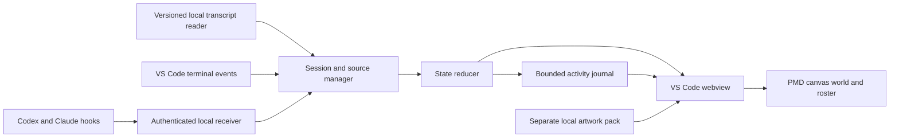
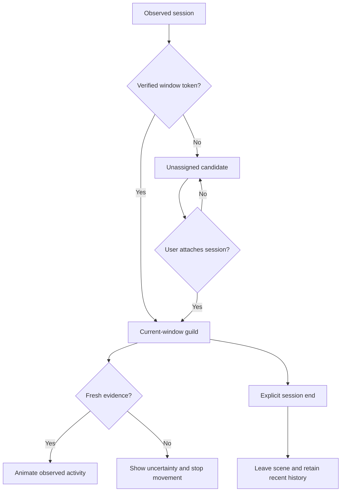

# PMD Agents

**Your coding agents, as a Pokémon Mystery Dungeon exploration team.**

PMD Agents is a local VS Code extension inspired by [Pixel Agents](https://github.com/pixel-agents-hq/pixel-agents). Codex chats, Claude Code sessions and terminal jobs appear as Pokémon in a PMD training ground: training against Substitute while working, scouting while reading, and stopping when they need your attention.

[](https://github.com/kevanwee/pmd-agents/actions/workflows/ci.yml)


> **Development build 0.2.0.** Terminal tracking and live Codex transcript observation are verified locally. Native Claude records have been replayed successfully; live Claude chat tracking still needs validation. This is an unofficial, non-commercial fan project.


*Screenshots use explicitly simulated sessions. They demonstrate the UI and animations, not live provider coverage.*

## What the guild does

- **Observes your existing workflow.** Keep using native Codex and Claude Code chats and VS Code terminals. PMD Agents is an observer, not a replacement chat client.
- **Uses authentic PMD animations.** Directional sheets, native frame durations, portraits and shadow anchors; no four-frame sprite assumptions.
- **Makes activity visible.** Working, editing and command-running sessions practise attacks and ranged moves against Substitute. Attention stops training immediately.
- **Keeps session identity stable.** Teammates joining or leaving does not reshuffle existing Pokémon. Extra sessions use additional clearings.
- **Shows its evidence.** An Activity journal lists observed events, timestamps and sources. Missing evidence becomes uncertainty, never invented success.
- **Lets you choose the team.** Attach ambiguous sessions, choose from twelve Pokémon, link an agent to its terminal, or remove it from the guild without stopping it.
- **Stays local.** No hosted backend, additional model calls or paid infrastructure is needed for observation. Existing agent usage keeps its own costs and limits.

## Screenshots

<table>
<tr>
<td width="50%"></td>
<td width="50%"></td>
</tr>
<tr><td>Observed activity, separated from animation.</td><td>Fan-project notice and individual credits.</td></tr>
</table>

## Pokémon roster

| Line | Available Pokémon |
| --- | --- |
| Grass starters | Bulbasaur · Ivysaur · Venusaur |
| Fire starters | Charmander · Charmeleon · Charizard |
| Water starters | Squirtle · Wartortle · Blastoise |
| Original team | Eevee · Riolu · Ceruledge |

Select a teammate, then choose its Pokémon in the portrait card. Existing default assignments stay stable as the catalog grows. Substitute is a training prop, not a selectable agent.


The import catalog lives in [`assets/roster.json`](assets/roster.json). Add future species there, run the importer, then validate sheets, native timing, portraits and credits before extending the roster. The complete Pokédex is a gradual expansion, not part of this build; the current pack validator caps a pack at 32 selectable species.

## Run locally

Requires **Node.js 22+**, npm and **VS Code 1.109+**. Importing artwork also requires Python 3 and Pillow. Windows local is the tested environment; remote hosts are not yet verified.

```powershell
git clone https://github.com/kevanwee/pmd-agents.git
cd pmd-agents
npm ci
npm run typecheck
npm test
npm run package
```

In VS Code:

1. Run **Extensions: Install from VSIX** and choose `artifacts/pmd-agents-0.2.0.vsix`.
2. Run **Developer: Reload Window**, then **PMD Agents: Open Guild**.
3. Choose a local artwork pack under **Connections → Choose asset pack**.
4. Attach the intended chat under **Connections**. A folder match alone does not prove that a chat belongs to this window.

The extension can observe sessions without artwork; the scene needs a complete local pack. It checks development `assets/local`, then `~/.pmd-agents/assets`, or the configured `pmdAgents.assetPath`.

### Import artwork

Source sheets and game maps are **not included in Git or the VSIX**. The current importer downloads pinned SpriteCollab sheets and reads the Thunder Meadow map and Pixelify Sans font from a local Voracity checkout. Without those local map/font inputs, obtain a compatible pack first; cloning this repository alone does not provide them.

```powershell
python -m pip install Pillow
python scripts/import-assets.py --voracity "path/to/voracity"
```

The importer writes `assets/local/manifest.json`, original credit records and file hashes. Use `--output` to select another local pack directory. See [asset handling and credits](docs/ATTRIBUTION.md).

### Connect agents

| Source | What works today | Practical limit |
| --- | --- | --- |
| Codex native VS Code chat | Live transcript observation verified on 0.162.0-alpha.2; hook adapter available | Explicit attach; native hook/approval coverage still needs validation |
| Claude native VS Code chat | Actual 2.1.289 records replayed; 2.1.292 schema inspected | A live native chat remains unverified |
| Claude CLI | Real startup hook received; lifecycle adapter implemented | Full live-turn coverage remains unverified |
| VS Code terminal | Open/close, shell command start/end and exit result verified | Without shell integration: terminal presence only |
| Other agent CLIs | Generic terminal activity | Internal reasoning, tools and children require an adapter |
| WSL, SSH, containers | Observer runs in the workspace extension host | Not tested; local Windows logs are not remote-host logs |

**Connections → Connect Codex / Connect Claude → Install hooks** shows the destination and writes the observer configuration for you. No copying or saving JSON is required. Unrelated settings are preserved, changed files are backed up, and **PMD Agents: Remove Provider Hooks** removes only this observer. Codex requires its own `/hooks` trust review. PMD Agents never grants provider approvals.

Use **Manage guild** to link a terminal-launched agent to its terminal. Native panel chats should stay separate from unrelated terminals. Attachments and links currently last for the extension activation; reattach after a reload. Character preferences are saved separately.

### Read the world

| Observed state | Pokémon behaviour |
| --- | --- |
| Working / thinking / responding | Attack and ranged animation cycles against Substitute |
| Reading / searching | Short patrol |
| Editing or running a command | Train against Substitute |
| Approval or input requested | Stop with an attention bubble |
| Turn finished | Rest, then sleep |
| Stale, paused or unavailable observation | Stop and show uncertainty |

Move colours follow the Pokémon’s theme: fire, water, grass, fighting or neutral. Attacks, projectiles and hit reactions are decorative; they do not count tool calls, measure progress or imply successful work.

Quiet and reduced-motion settings stop movement while keeping status visible. “Turn finished” does not mean the requested software is correct or the whole task is complete. A generic command exiting zero is not automatically a test pass.

## How it works



The host hashes provider identities and discards prompts, arguments, outputs and full paths before sending state to the view. Transcript readers inspect local record structure; raw chat text is neither retained in the journal nor uploaded.



Hooks take priority over transcript replay. After hook silence, a newer live transcript event can recover observation; time alone never produces success. Tool activity is tracked concurrently, with duplicate and late-event protection. A linked terminal closing does not automatically end its provider session.

## Development and verification

```powershell
npm run typecheck
npm test
npm run build
npx playwright install chromium
npm run test:browser
npm run test:extension
npm run package
```

- Unit checks cover event ordering, attention, window membership, source recovery, bounded history, stable placement, transport and parsing.
- The asset integrity test runs when the ignored local pack exists; source-only CI reports it skipped.
- Browser checks require that pack and start a temporary preview server automatically. They verify motion, attention stops, clearings, journal contents and narrow layouts.
- VS Code tests launch an isolated profile and exercise real shell integration. Set `PMD_VSCODE_EXECUTABLE` for another installation.
- `npm run preview` opens a browser demo at `http://127.0.0.1:5188`; it is not a live browser monitor.
- `npm run screenshots` regenerates the committed, labelled demo screenshots. Real session screenshots, logs and probe exports stay in ignored `artifacts`.

GitHub Actions currently cannot start jobs because of an account billing/spending restriction. Local checks below have passed; no billing settings were changed.

The local build has **36 passing focused tests**, plus browser and VS Code integration checks. CI verifies source-only checks, not native provider coverage. See the dated [implementation evidence](docs/IMPLEMENTATION.md) for exact versions and gaps.

## Roadmap

- [x] Archive The Office and establish a separate PMD architecture
- [x] Real PMD scene, native animation metadata, portraits and credits
- [x] Terminal observation, Codex transcript observation and explicit attachment
- [x] Activity journal, stable placement, attention and terminal linking
- [ ] Live Claude native-chat and both providers' approval/subagent validation
- [x] Bounded historical-folder discovery for resumed Codex sessions
- [x] Substitute training and all nine Kanto starter stages
- [ ] Window-safe attachment restoration and process reconciliation
- [ ] More verified Pokémon, maps and optional dungeon presentation

The [full plan](docs/PLAN.md) separates delivered work from future proposals. [Research](docs/RESEARCH.md) records the predecessor review and archive receipt.

## Credits and licence

Built by **Kevan Wee**. Inspired by **Pablo De Lucca and the Pixel Agents contributors**; no Pixel Agents source code is copied in this implementation. [The Office](https://github.com/kevanwee/theoffice) is the archived predecessor; Voracity supplied the visual references and local asset-pipeline lessons.

Sprite/portrait records credit **CHUNSOFT, baronessfaron, Fearless-Quit, Top_Kec, JFain, 0palite, Emboarger, Emmuffin, Grimlin, G〜 and bwappi**, plus contributors recorded upstream as Discord IDs **199989579682414592** and **276175146304405514**, sourced through [PMD SpriteCollab](https://github.com/PMDCollab/SpriteCollab). Original game sprites and individual fan-art terms are distinguished in the pack; a repository-wide fan-art licence is not assumed to cover every asset. **Pixelify Sans Project Authors** provide the font under SIL OFL. Thunder Meadow is a local game-map reference; its original ripper remains unresolved. Screenshots contain rendered third-party artwork and retain those attributions.

Original project code is currently **all rights reserved**; see [LICENSE](LICENSE) and [NOTICE.md](NOTICE.md). This repository does not grant redistribution rights to third-party artwork. Source sheets and game maps remain outside the repository and installable package.

**PMD Agents is an unofficial, non-commercial Pokémon Mystery Dungeon fan project.** It is not affiliated with, endorsed by or sponsored by Nintendo, Creatures Inc., GAME FREAK, The Pokémon Company or Spike Chunsoft. Pokémon and Pokémon Mystery Dungeon names, characters and game artwork belong to their respective owners.
