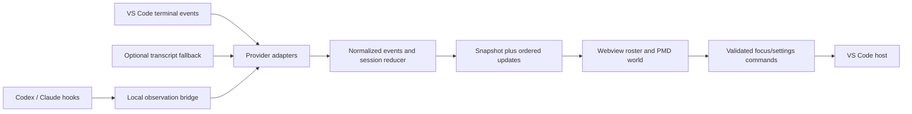

# PMD Agents — product and engineering plan

9 October 2026 · working name `pmd-agents` · proposal, not implemented functionality.

The Office is archived. Build a separate VS Code extension that turns the agents working in the current window into an exploration team in a Pokémon Mystery Dungeon world. It should answer three questions at a glance: **Who is working? What are they doing? Who needs me?**

The central decision is to model a guild and its activities, with genuine PMD movement and combat animations. A Pokémon walking to a computer would repeat the original mismatch. The visual experience and the accuracy of session tracking are equally important release requirements.

## 1. Product contract

- Every identified agent session has one persistent Pokémon. Real child agents can become distinct teammates. A terminal is a source/container, not automatically an agent.
- Existing Codex and Claude chats must be considered, not only sessions created using our launcher.
- All terminals in this VS Code window are discoverable; their internal semantics depend on available integration. An ordinary terminal job can be represented as a job without pretending it is an AI agent.
- Session state comes from observed events. Animation expresses state; it never determines whether a task succeeded.
- Use PMD sheets, portraits, maps and dialogue styling. Preserve original proportions, facing and timing. Use native game maps where their provenance and intended use have been addressed.
- Work locally using installed tools and their existing authentication. Observation introduces no model calls, paid API, billing, database or hosted background service. Existing agent usage retains its own costs and limits.
- Default scope is the current VS Code window, including its workspace folders and terminals. Do not absorb every session on the computer because it shares a folder.

“Universal” means a common adapter contract and useful fallback coverage. It cannot mean that an arbitrary closed chat UI exposes all its internal events. Unsupported or ambiguous sources must be visible as such. The feasibility milestone must establish the actual coverage of the owner's installed clients before advertising support.

## 2. The world: an exploration guild

Use **Exploration Guild** as the default scene concept. The owner is overseeing a team, not playing a separate RPG while agents work. Keep the PMD aesthetic rich and the controls compact.

The first scene is a small outdoor guild training ground, with a gathering point, training positions and resting spots. A PMD map study uses the already available Friend Areas; the final default can be a suitable dojo/guild map after sourcing. Start with one coherent scene rather than shipping several incomplete maps.

| Real state/activity | World behaviour | Plain UI label |
| --- | --- | --- |
| Session joins | Walk in from a valid entrance, then greet | Connected |
| Turn active, activity unspecified | Ready stance at its current position | Working |
| Reading files or searching | Scout nearby walkable tiles; pause to inspect a board/map when available | Reading / Searching |
| Writing or editing | Face a training dummy and use the species' Attack/Strike animation, with small hit feedback | Editing |
| Running a known test/build | Training bout against a clearly labelled practice opponent, or dummy if no opponent asset exists | Testing / Building |
| Other shell command | Move through a short training/exploration circuit | Running command |
| Waiting on tool/network | Pause in a ready pose with a restrained waiting icon | Waiting for tool |
| Explicit approval requested | Stop immediately; amber “!” and portrait dialogue card | Approval needed |
| Explicit question/input request | Face the viewer; “?” and the relevant session action | Needs input |
| Turn ended normally | Short happy pose if available, then rest | Turn finished |
| Explicit failure or interrupt | One subdued recoil/surprise pose, then a stable marker | Failed / Interrupted |
| Idle session | Wander a short distance or sleep at its resting spot | Idle |
| Observation lost | Freeze work loop, retain actor with an uncertainty marker | Connection lost / Status unknown |
| Session ended | Leave through an exit; retain a short recent-session entry | Session closed |

“Turn finished” does not mean the requested software is correct, tests passed, or the whole task is complete. Show test success only when a recognized test result supports it. Do not derive testing from arbitrary command substrings alone; unclassified shell work stays generic.

### Why dummies first, battles second

Dummies give independent agents somewhere meaningful to work without inventing a relationship between them. Each active agent reserves a training position or uses a safe overflow position. Visual attacks repeat at a restrained cadence while work continues; hits are decorative, not tool counts or progress percentages.

Sparring is an optional presentation of test/build activity against an NPC. Two real agents do not automatically fight each other: they are usually collaborators. If the user chooses sparring between teammates later, mark it as cosmetic. Real parent/child relationships are shown as exploration parties, with child identity and source preserved. Do not force pairs everywhere.

There are no default fake HP bars, token-to-damage conversions, XP for elapsed time, or inferred percentage progress. A later optional mission log can record observed outcomes without ranking code quality.

### Expansion scenes

1. **Training ground / dojo:** compact default, clearest glanceable activity.
2. **Friend Area:** calmer ambient view; Transform Forest and Thunder Meadow are existing visual references.
3. **Dungeon expedition:** optional later view where a parent and its real subagents explore together. Rooms and encounters represent activity categories, not fabricated subtasks or completion milestones.
4. **Guild interior / mission board:** later home for explicit task assignments if orchestration becomes a separate authorized feature.

Candidates such as Makuhita Dojo or Wigglytuff's Guild are art-direction targets, not assets already obtained or cleared. Do not postpone a working vertical slice until an entire game world is reconstructed.

## 3. Screen and interactions

The extension opens as a dockable VS Code webview, usable in the bottom panel or as an editor tab for more room.

```text
 [Current window ▾]  Guild / Friend Area     [Team] [Connections] [Settings]
 ┌───────────────────────────────────────────────────────────────────┐
 │                                                                   │
 │   entrance      scout area             dummy / practice opponent   │
 │                    Pokémon A                 Pokémon B             │
 │                                                                   │
 │                 gathering point          resting spots             │
 │                                               Pokémon C           │
 ├───────────────────────────────────────────────────────────────────┤
 │ portrait  Codex · Ceruledge        Editing · connected              │
 │           Voracity · current turn      [Focus session] [Details]    │
 └───────────────────────────────────────────────────────────────────┘
```

This is a layout schematic, not a claim that a game map contains those props.

- Map dominates the view. Labels appear on selection, hover or attention; a compact roster remains available for all agents.
- Click a Pokémon to select it and see a PMD portrait card. “Focus session” reveals the exact terminal or supported chat target. If an extension lacks an exact-session deep link, say “Open Codex/Claude panel” rather than claiming to focus a specific conversation.
- Keyboard roster navigation provides every essential action independently of the canvas. Status changes use a throttled live region. Colour is accompanied by text and icons.
- Attention roster sorts approvals and questions first. Clicking a bubble navigates to the provider's own approval UI; it never grants approval.
- Character picker shows species, forms, shiny variants, portraits and available animation capabilities. Start with a verified small roster, then expand through asset packs. Preserve assignments across panel hides, resize, provider events and reconnects.
- Ship an initial roster candidate list: Eevee, Riolu, Pikachu, Treecko, Fuecoco, Charcadet, Ceruledge and Diancie. Exact inclusion depends on animation and attribution audit; availability in Voracity does not imply complete sets.
- Empty state shows an empty guild and “No sessions connected,” with connection setup. Any demonstration actors live behind a conspicuous Demo switch and never mix with real sessions.
- At narrow widths, the map crops/pans, the roster becomes a drawer, and the details card stacks. Do not shrink every Pokémon into unreadable pixels to fit the whole map.
- Quiet mode and reduced motion retain statuses and still frames while disabling roaming, attack loops, flashes and camera easing. Sound starts off. No soundtrack in the initial release.
- Map layout changes affect presentation only. Moving a Pokémon never changes its project, session or real task.

## 4. Integration strategy and support tiers

Use a provider-neutral observation layer. Public documented hooks/protocols are preferred; a versioned transcript reader is a fallback. Do not scrape chat webviews, intercept private extension internals, or build around undocumented guessed events.

| Source | Primary planned route | Reliable scope to prove | Limits / fallback |
| --- | --- | --- | --- |
| Claude Code terminal | Lifecycle/tool hooks | Session, tool, attention, end and supported child events | Version probe; optional bounded transcript reader |
| Claude Code VS Code chat | Same provider hook route, tested separately | Actual events from the installed extension runtime | Do not assume CLI version equals extension runtime; binding to window may need explicit attach |
| Codex terminal | Current documented hooks where supported | Session/turn/tool/attention events available in that runtime | Versioned local log fallback; unsupported events stay unknown |
| Codex VS Code chat | Test lifecycle hooks in that client first | Events from the native chat, not a second replacement chat | Hook availability and exact window attribution are Phase 0 gates; explicit attach when needed |
| Codex hosted by PMD Agents, later | App Server protocol | Events from sessions we intentionally host | Optional separate mode, not a back door into another extension's session |
| Ordinary integrated terminal | Stable terminal lifecycle and shell execution events | Open/closed, command running/ended, exit result when supplied | Without shell integration: terminal present, internal activity unknown |
| Nested agent/child process | Provider subagent ID or explicit bridge registration | Parent/child association and lifetime | Do not spawn one Pokémon for every compiler or subprocess |
| Other agent CLIs | Generic shell coverage, then adapter or `pmd-agents emit` bridge | Declared capabilities only | A long-running TUI is one running command until richer events exist |
| External terminals / separate desktop chats | Optional explicit attach in a later scope | Only what the installed bridge can attest | Excluded from automatic current-window discovery |

Sources and observed local versions are recorded in [RESEARCH.md](RESEARCH.md). These are planned integrations, not a passed compatibility matrix.

### Binding a session to the right VS Code instance

Create a random `windowInstanceId` for the extension activation and a local registration endpoint. Terminals launched after activation receive a window token through the extension's environment collection; first-party launch commands also include an opaque launch ID. Existing terminal handles can be enumerated, but may not receive new environment values until relaunched.

Provider events must be bound by an explicit window/launch token, verified terminal association, or a user's explicit attach choice. `cwd`, timing and PID ancestry can suggest candidates, but shared folders and multiple windows make them insufficient alone. Extension-hosted chats may not inherit terminal environment values; the UI must offer “Attach this session” for candidates and expose why automatic attribution failed.

Use a durable provider session key plus host identity and child ID where needed. Keep window attachment separate from that key so a reload can restore an assignment without duplicating the Pokémon. A new terminal session gets a new session binding; persisted preferences do not resurrect an ended job.

Reject conflicting automatic claims. Show unassigned candidates separately, never as confirmed current-window agents. Expire dead registrations, track host restarts, and allow deliberate reattachment. Two windows open on the same repository are a required test, not an edge case to ignore.

### Setup and diagnostics

Connections lists each installed client, detected version, observation mode, supported events, hook registration health and last event time. Use labels such as Connected, Limited, Needs setup and Disconnected.

When implementing setup, show the exact settings diff, preserve existing hooks, back up touched files, and support surgical uninstall. Codex's own hook trust step must be honoured. The observer must never alter approval decisions, tool input or prompts; it exits successfully without model-facing output even when telemetry delivery fails. No bypass flags are required.

## 5. Architecture

Recommend a clean TypeScript codebase with a small VS Code extension host, pure state core, provider adapters and a React/Canvas 2D webview. Use Vite for the webview and esbuild for the extension. Keep npm workspaces modest; do not add a service framework until needed.



```text
apps/vscode/               activation, terminals, webview, settings, focus
apps/webview/              React controls, accessible roster, canvas scene
packages/core/             events, reducer, identities, capabilities, snapshots
packages/providers/        codex, claude, terminal, optional fallback readers
packages/world/            maps, paths, zones, actor behaviour, animation player
packages/assets/           importer, manifests, validation, generated metadata
fixtures/                  synthetic/redacted provider events and replay scenarios
docs/                      plan, architecture, support matrix, notices
```

Keep the core independent of VS Code and artwork so it can later support a standalone viewer. Do not build the browser server or an orchestration backend in the first release.

### Event and state contracts

Normalized events include: schema version, event ID, provider, host/session/child identifiers, attachment ID, turn/tool IDs where supplied, event kind, observed time, receipt time, evidence source, and capability/confidence metadata. Use enums for activity categories rather than raw prompts or tool arguments.

State has independent dimensions:

- **Lifecycle:** discovered, attached, ended.
- **Connection:** live, degraded, disconnected, unknown.
- **Activity:** idle, working, reading, editing, running, testing, waiting-tool.
- **Attention:** none, input, approval, error.
- **Outcome:** absent, turn-finished, failed, interrupted; optional separately verified command/test results.

Track concurrent tools in a set/map. A single tool ending must not idle a session with other work still running. Attention cues override visual work animations without erasing underlying state. Closing a session is distinct from ending a turn.

Deduplicate native provider/tool IDs when available. Where providers lack ordered IDs, assign receiver sequence numbers, retain source timestamps and bound deduplication by an event fingerprint. Handle out-of-order starts/ends through a reducer with tombstones and reconciliation; do not assume wall clocks establish perfect order. Hook and transcript observations of the same event must not create two actors or double-count work.

Timeouts mean uncertainty, not completion. Lack of tool output may be a legitimate long run. A bridge heartbeat proves bridge health, not the liveness of every provider session. Reconcile process/session state where supported and otherwise preserve last-known activity with a stale marker.

The webview receives a complete revisioned snapshot on startup, then ordered deltas. A sequence gap or panel reload triggers resynchronization. Hiding the panel pauses drawing while the host keeps observing. Visual travel/attack durations never delay attention labels.

## 6. PMD asset and map pipeline

### Sprite ingestion

Import a pinned, reviewed set of PMD SpriteCollab files and their credit records. Reuse the lessons from Voracity's importers rather than copying assumptions from its small portrait renderer.

The importer must handle per-animation frame width/height, frame durations, direction rows, `CopyOf` aliases, attack timing markers, and available offset/shadow sheets. Resolve aliases with cycle detection. Confirm the source timing convention and row order against known animations; do not blindly treat a duration as milliseconds.

Each runtime animation declares its frame rectangles, durations, anchors, facings and effects markers. Species declare capabilities. Minimum acceptance for an animated team member is Idle and Walk; Attack is required for full training behaviour. If an action is absent, use an honest fallback pose and status label, not an unrelated animation or fabricated direction.

Use stable foot/body anchors across animations. Independent tight cropping of every frame makes Pokémon jitter; determine common animation bounds and preserve supplied offsets. Size species by body and natural proportions, not the outer bounding box of wings or weapons. Shiny variants use real sheets when available; no generic hue filter.

Start with a small complete roster. Lazy-load selected species and the active map. Do not promise all Pokémon because a static icon catalog contains them.

### Maps are scenes with geometry

An image alone is not a usable world. A map manifest contains native dimensions, ground image/layers, foreground occlusion, walkable polygons or grid, obstacles, entrances/exits, activity anchors, facing at anchors, capacity and camera bounds.

Voracity provides two concrete references:

- **Transform Forest (480 × 312):** attractive resting/gathering scene, but the central stone and narrow clearing constrain capacity. Preserve its stone exclusion and original coordinate system.
- **Thunder Meadow (456 × 335):** open training-study candidate with a large central tree and cliff edges. Preserve the tree obstacle; evaluate capacity before selecting it as the default.

For full game maps, verify whether the image is a flattened rip or layered tiles. Extract a foreground mask where required so Pokémon can walk behind trees/walls correctly. If a region cannot be separated cleanly, route around it. Do not leave the office collision grid underneath a PMD background.

Use bounded A* or BFS on authored walkable geometry, no diagonal corner cutting, and per-actor clearance. Reserve interaction anchors and separate occupancy from static obstacles. Bound replanning and provide an idle-in-place fallback if a destination cannot be reached. Overflow creates additional valid activity slots or a selectable area, not characters stacked inside trees.

Keep map coordinates independent of CSS size. Draw at integer pixel scales when practical, snap to physical pixels, disable smoothing, and Y-sort by ground contact. Foreground layers and effects have explicit draw order. Pan/zoom the same scene transform for image, actors, hit testing and overlays.

### Renderer and performance

Use one animation loop and a fixed simulation step with a capped accumulated delta. Cache static layers; keep frame updates out of React state. Stop the loop when the panel is hidden; resync state on return without rerolling characters. Reduced motion uses static poses and immediate camera changes.

Initial measurement targets, to validate on the owner's machine: p95 hook-to-label latency below one second locally; 20 visible agents without sustained frame drops at a 30 fps target; hidden webview does no animation work; no unbounded event or texture growth during a one-hour replay. Treat these as targets, not benchmark results.

## 7. Local safety, persistence and remote hosts

The extension owns a bounded local event receiver. Prefer per-user IPC where practical; otherwise bind loopback only, require a random capability token, validate payload size/schema, reject unexpected origins/routes and do not enable open CORS. Same-user software can read many local resources: this is not isolation from a compromised user account.

Strip prompts, tool inputs/results, environment variables, credentials and raw terminal output before transport or persistence. Default details are provider, sanitized activity category, relative location when useful and timestamps. Do not store hidden reasoning. Optional diagnostics use a bounded local ring buffer and explicit redacted export.

Webview access uses VS Code's resource URIs, a restrictive CSP and a validated message allowlist. Do not allow the webview to submit arbitrary shell commands or filesystem paths. Validate imported manifests, asset dimensions, file counts, archive paths and decompression limits. Workspace Trust gates hook setup and any execution; an untrusted workspace may show a disconnected/static UI.

Store character preferences and scene choices in extension storage. Store session bindings per workspace/window with host identity and expiry; tokens use OS/extension secret storage or a private runtime directory as appropriate. Atomic writes and schema migrations keep corrupted settings recoverable. Do not read or migrate `~/.the-office` automatically.

For WSL, SSH and containers, observation must run beside the agent on that host. Use VS Code's extension-host bridge to the UI; localhost on Windows is not localhost inside every remote. Windows local is the first tested environment. Remote combinations remain explicitly unverified until exercised. Design host IDs into the schema now so a later remote adapter is not a rewrite.

## 8. Credits and distribution

Follow [ATTRIBUTION.md](ATTRIBUTION.md). Carry the fan disclaimer into README, Credits and any eventual listing; retain Pixel Agents' upstream notice for reused code and individual sprite contributors. Map rips need separate provenance and distribution consideration. The code licence does not cover artwork automatically.

The planning folder is local and contains no runtime artwork. Begin implementation as a private/local project; source visibility and public asset packaging can be decided once the inventory is concrete. The first installable milestone is a local VSIX. Public marketplace publishing, paid services and replacing existing chats are not prerequisites.

## 9. Delivery sequence and acceptance gates

| Phase | Deliverable | Acceptance before moving on |
| --- | --- | --- |
| 0 — feasibility | Thin extension/receiver spike, coverage report, PMD animation/map study | Real Codex native chat, Claude native chat and an existing terminal each attempted on this machine; actual emitted events recorded as sanitized fixtures; same-folder two-window attribution tested; unsupported paths reported; one real Pokémon walks/attacks correctly on a local PMD map |
| 1 — trustworthy core | Contracts, reducer, binding, replay, diagnostics and terminal adapter | No phantom sessions or timer-based successes; start/end/reorder/duplicate/disconnect scenarios pass; current-window scope holds |
| 2 — first playable-looking slice | One training scene, 3–8 verified Pokémon, roster, portrait card, real provider connection | A live supported session changes work/attention/idle state visibly; source focus works within documented limits; native frames, collisions and occlusion pass visual review; demo mode clearly separate |
| 3 — provider coverage | Complete Claude/Codex adapters, existing-session attach, subagents and fallback readers where justified | CLI and native chat tested independently; simultaneous same-folder sessions remain distinct; parent-child lifetime accurate; missing capabilities visible |
| 4 — daily-use polish | Persistence, picker, map selection, quiet mode, packaging, notices | Reload restores identity; narrow panel usable; keyboard access complete; no private content in package; failed/missing assets recover; credits complete; performance targets measured |
| 5 — optional expansion | Dungeon view, more maps/packs, remote-host support, semantic map editor | Separate scoped increments with live tests and asset provenance; no reduction of established observation fidelity |

Phase 0 has two independent proofs: telemetry and visual fidelity. A beautiful disconnected demo is insufficient; an accurate status list with badly animated sprites is also insufficient. If native Codex chat cannot emit usable events in the installed client, record the exact limitation and attach/fallback proposal before broadening promises.

Estimate only after Phase 0. Integration uncertainty, window attribution and artwork preparation dominate; a fixed delivery date now would hide those risks.

### Required validation scenarios

1. Codex native chat and Claude native chat work concurrently with a manually opened terminal; none must be relaunched through our UI just to be visible at the appropriate support tier.
2. Two Codex sessions in one folder, two VS Code windows on that folder, and a multi-root workspace do not cross-bind or duplicate actors.
3. Prompt, tool start/end, concurrent tools, approval, input, turn finish, explicit failure, user interrupt, subagent start/end and terminal close have distinct results.
4. Extension activation after a session starts, webview close/reopen, extension reload, sleep/resume, collector restart and lost events preserve identity and report uncertainty.
5. Transcript fallback handles partial UTF-8/JSONL, truncation, rotation and version mismatch with bounded reads; unknown formats degrade visibly.
6. Generic shell integration absent/present, nonzero exit and long-running commands show only what is known. One build process does not become dozens of fake agents.
7. Forged/malformed events, wrong tokens, untrusted workspace requests and unsafe asset paths are rejected. Fixtures and exports contain no private prompts or credentials.
8. All sprite directions and actions render without clipping/jitter; attacks face targets and hit effects align with metadata. Routes never cross trees, walls or cliffs.
9. 320px/480px-wide side panels and a wide editor view keep controls reachable. Keyboard, zoom, reduced motion and hidden-panel behaviour work.
10. A release package has complete notices, no unresolved bundled assets, no unrelated Voracity material and no debug data.

Use reducer/adapter unit tests for correctness; replay fixtures for end-to-end state; VS Code integration tests for terminals and window lifecycle; browser tests and actual screenshots for rendering. A browser mock does not prove native chat integration. Maintain a dated manual client/version matrix with pass/fail/limited evidence.

## 10. Recommended first implementation brief

> Implement Phase 0 in this separate project. Read the plan and preserve the archived repository and Voracity. Build the smallest observer that can report real events from the installed Codex chat, Claude Code chat and current-window terminals without exposing chat content. Test window binding rather than guessing from cwd. In a separate replay view, import one complete PMD Pokémon and one existing local map with collision metadata and provenance, and demonstrate Idle, Walk, Attack and attention. Deliver a support matrix, screenshots, sanitized fixtures and a precise gap list. Do not implement the full editor, dungeon game, task orchestration or public distribution yet.

The request that produced this document authorizes archive and planning. This brief makes the next implementation step concrete; it is not a record that Phase 0 has already run.
